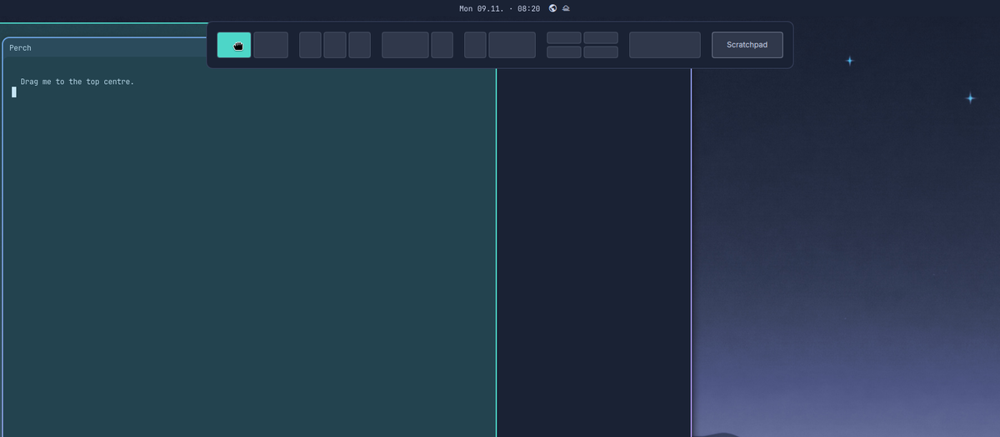

# Window Zones

Window snapping for [Omarchy](https://omarchy.org)'s floating workspaces, in the spirit of
Windows 11 snap layouts and PowerToys FancyZones: drag a window, drop it into a zone.



- **Screen edges.** Drag a window to the left or right edge: a preview shows
  the half it will take, and dropping puts it there. Halves keep Omarchy's gaps,
  so corners and shadows stay visible.
- **Layout panel.** Drag a window to the top centre, under the clock: a panel
  drops down with layouts (halves, thirds, ⅔ + ⅓, quarters, full). Drop on a cell
  and the window fills it.
- **Scratchpad.** The last tile in the panel sends the window to the scratchpad,
  like <kbd>Super</kbd> + <kbd>Alt</kbd> + <kbd>S</kbd>.
- **Drag out.** Pulling a placed window away gives it back its earlier size.
- **No key bindings.** Window Zones adds none, so every Omarchy shortcut keeps working.

Works with titlebar drags and <kbd>Super</kbd> + left-drag, on every monitor.
The dock is kept clear unless it auto-hides.

## Install

Omarchy 4.5 or later.

```sh
omarchy plugin add https://github.com/DerJungeHerr/omarchy-window-zones --enable
```

Remove it with `omarchy plugin remove io.github.derjungeherr.window-zones`.

## How it works

Hyprland has no drag events, and Omarchy's titlebars take the click before any
binding sees it. So `hypr/window-zones.lua`, which the shell service loads into
Hyprland with `hyprctl eval`, watches instead:

- Every 50 ms it compares the active window with the cursor. A floating window
  that moves exactly as the cursor does is being dragged.
- While dragging, it tracks the cursor every 16 ms and tells the overlay
  (`Service.qml`) what to show, only when that changes.
- A release is seen when the cursor moves on without the window. If both stand
  still over a target, Window Zones nudges the cursor one pixel: a held window follows,
  a dropped one does not, and the cursor goes back.

Nothing is written to your config files.

## Limits

- Floating workspaces only (windows tagged `omarchy-floating-workspace`);
  pinned, fullscreen and grouped windows are left alone.
- A very short flick can finish before Window Zones notices the drag.
- Apps with a minimum size may not shrink into a small cell.
- A Hyprland config reload forgets earlier sizes: a window placed before it keeps its placed size when dragged out.

## Development

```sh
lua test/window-zones.test.lua   # geometry, hit tests and JSON, without Hyprland
```

Link the checkout into `~/.config/omarchy/plugins/io.github.derjungeherr.window-zones`,
enable it, and run `omarchy restart shell` after adding files.

## License

MIT
